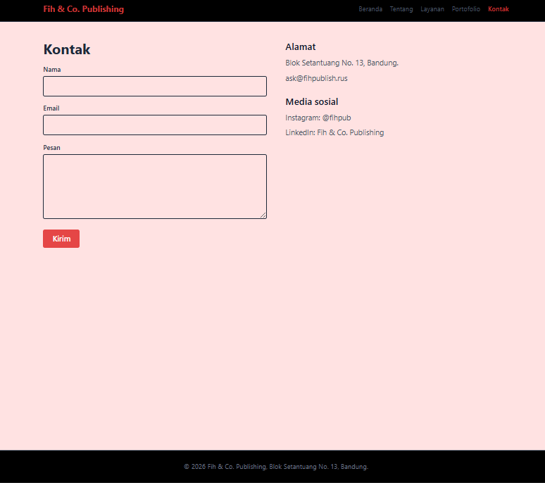

# Idenfitikasi
Nama: Rayhan Ilham Rabbani  
NIM: 2505584  
Prodi: Pilkom 3C  
# Deskripsi
Website perusahaan fiktif bernama Fih & Co. Publishing yang berfokus pada menerbitkan karya anti-mainstream dari author indie dsb.
# Cara menjalankan
Instalasi:
npm install
Menjalankan:
npm run dev

Buka http://localhost:5173/
# Screenshots

# React + Vite

This template provides a minimal setup to get React working in Vite with HMR and some ESLint rules.

Currently, two official plugins are available:

- [@vitejs/plugin-react](https://github.com/vitejs/vite-plugin-react/blob/main/packages/plugin-react) uses [Oxc](https://oxc.rs)
- [@vitejs/plugin-react-swc](https://github.com/vitejs/vite-plugin-react/blob/main/packages/plugin-react-swc) uses [SWC](https://swc.rs/)

## React Compiler

The React Compiler is not enabled on this template because of its impact on dev & build performances. To add it, see [this documentation](https://react.dev/learn/react-compiler/installation).

## Expanding the ESLint configuration

If you are developing a production application, we recommend using TypeScript with type-aware lint rules enabled. Check out the [TS template](https://github.com/vitejs/vite/tree/main/packages/create-vite/template-react-ts) for information on how to integrate TypeScript and [`typescript-eslint`](https://typescript-eslint.io) in your project.

if kang radit sees this be cool